# Using VectorXR

This guide walks you through VectorXR from a fresh install to a working per-game setup.
For install steps and the project overview, see the
[README](../README.md).

VectorXR has two parts working together:

- the **desktop app**, where you configure everything, and
- the **OpenXR API layer**, which applies your settings at runtime while a VR app is running.

You do not need to keep the desktop app open for the layer to work — the layer reads the saved
config file directly. Settings are stored locally under `%LOCALAPPDATA%\VectorXR`.

## What you see on first launch

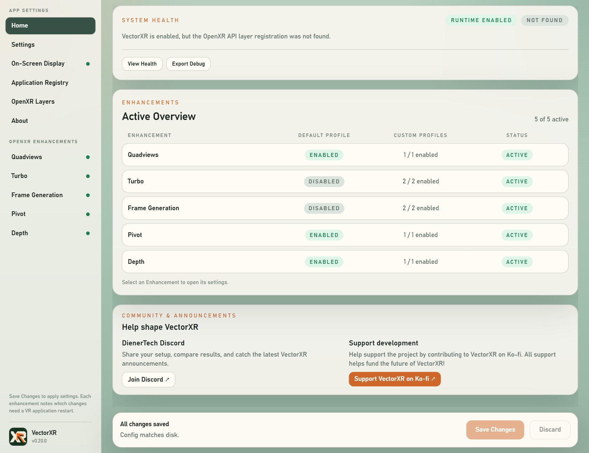

The **Home** tab is a status dashboard:

- **System Health** shows whether the runtime is enabled and the VectorXR layer is registered.
  Use **View Health** for details or **Export Debug** to collect a support ZIP.
- The **Active overview** lists the five Enhancements — **Quadviews**, **Turbo**, **Frame
  Generation**, **Pivot**, and **Depth**, including the default profile and enabled custom-profile counts. These summarize
  your configuration; an Active badge does not mean a VR application is currently running.
- The left sidebar holds app sections (Home, Settings, On-Screen Display, Application Registry,
  OpenXR Layers, About) and the five Enhancements. A green dot marks an Enhancement with an
  enabled default or custom profile.
- The bar at the bottom is the **save bar**. Changes you make are staged until you click **Save
  Changes** (or **Discard**). Watch this bar — nothing you change takes effect until it's saved.
- **Community & Announcements** provides access to the DienerTech Discord and Ko-fi support.

## How VectorXR decides what to apply

This is the core idea, so it's worth understanding before you start clicking. For each
Enhancement, settings resolve in layers:

1. **Runtime master switch** — *VectorXR Enabled* in **Settings**. If this is off, no
   Enhancement does anything, regardless of profiles. It is on by default.
2. **Default Profile** — one baseline per Enhancement. It *applies to applications without an
   enabled custom profile*. Ships **off**. Turn it on when you want an Enhancement to apply
   broadly to anything you haven't given a specific profile.
3. **Custom Profiles** — each targets one or more registered applications. **The first enabled
   custom profile that matches the running app wins** — it turns that Enhancement on for that
   app and applies its settings, *even if the Default Profile is off*.

So there are two ways to turn an Enhancement on for a game:

- **Default Profile on** → applies everywhere that doesn't have a custom profile (simple, global).
- **A custom profile targeting that game** → applies only to that game, and overrides the default.

If two enabled profiles target the same app, the first enabled one wins, and the app warns you
about the conflict so it is never silent.

## Step 1 — Confirm the runtime is enabled

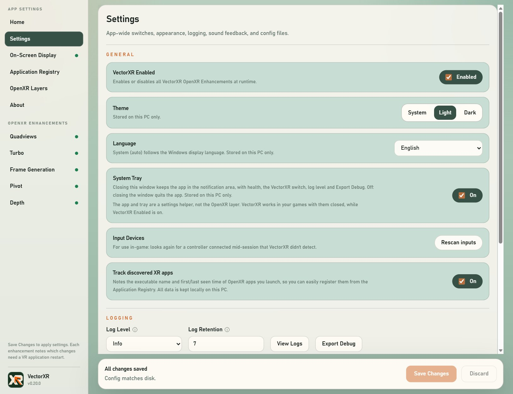

Open **Settings** and check that **VectorXR Enabled** is on (it is by default). This is the
single master switch for all Enhancements at runtime.

While you're here:

- **General** also holds the **Theme** (System / Light / Dark, stored on this PC only) and
  **Track discovered XR apps**, which is on by default. It records the executable name of OpenXR
  apps you launch so you can register them in one click later (see Step 2). All data stays local.
- **Logging** sets the **Log Level** and **Log Retention** and opens the log folder with
  **View Logs**.
- **Sound Feedback** sets the master volume for the activate/deactivate cues you can attach to
  bindings; **Test** plays a sample.
- **Config Files** moves your full configuration between machines or backs it up with
  **Import Config** / **Export Config**, shows where it is stored, and **Reset to Default**
  rebuilds the config and clears discovery data.

## Step 2 — Register the app you want to tune

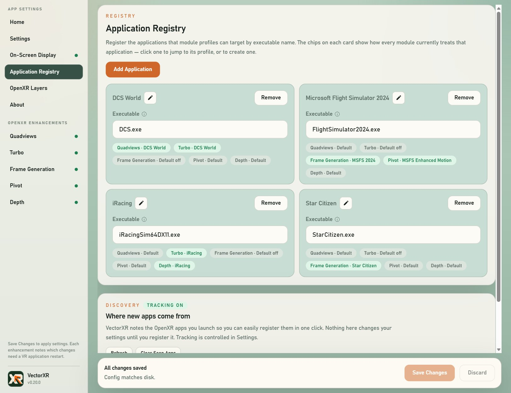

Custom profiles target apps by executable name, so first register the app in the **Application
Registry**. On first run it's empty ("No applications registered yet").

Two ways to add one:

- **Add Application** — enter the app manually (name + executable, e.g. `DCS.exe`).
- **From discovery (recommended)** — the **Where new apps come from** panel lists OpenXR apps
  VectorXR has *seen*. Launch your VR app once while VectorXR is active, come back, click
  **Refresh**, and register it in one click — no need to guess the executable name. Nothing here
  changes your settings until you actually register an app.

## Step 3 — Turn on an Enhancement

Open an Enhancement from the sidebar. Each one has the same shape: a **Default Profile** at the
top and a **Custom Profiles** list below. To apply it to the app you just registered, click
**Add Profile**, point the profile at that application, tune the values, and save. To apply it
broadly instead, just turn the **Default Profile** on.

The five Enhancements:

### Depth

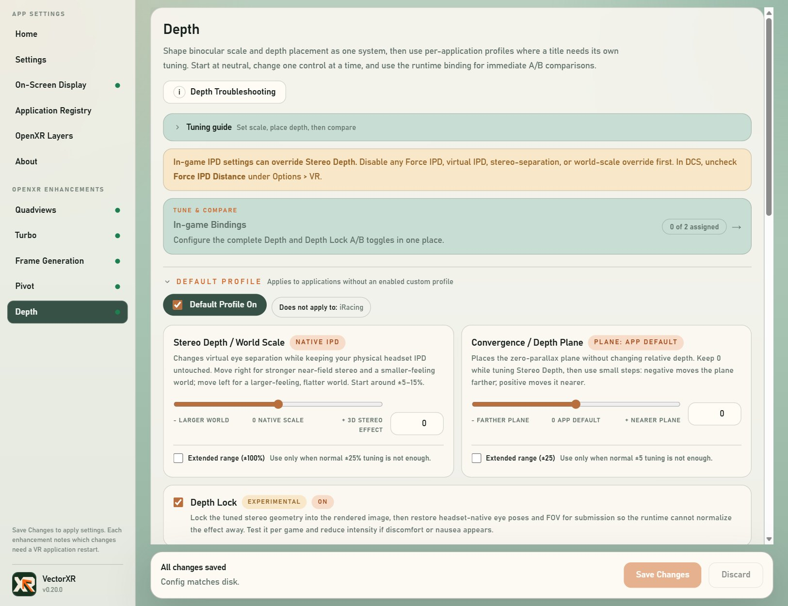

Depth adjusts virtual eye separation and projection convergence as one binocular system. Stereo
Depth controls perceived world scale; Convergence places the zero-parallax depth plane. The
collapsible **Tuning guide** summarizes the order below; it starts open until a Depth profile is
enabled.

- Begin with **Convergence at 0**. Move **Stereo Depth / World Scale** left to increase apparent
  scale when a cockpit feels miniaturized, or right for stronger stereo shape and a more compact
  world. Nearby geometry changes more visibly than the horizon. The normal range is ±25%; enable
  its explicit extended range only when you intentionally need the full ±100%.
- Once scale feels right, adjust **Convergence / Depth Plane** in small 0.1–0.5 steps. Negative
  moves the plane farther away; positive moves it nearer. The normal control is limited to ±5 for
  comfort. Enable the explicit extended range only for an existing profile or careful testing.
- **Depth Lock** preserves the tuned stereo image by restoring headset-native geometry when the
  projection layer is submitted, preventing the runtime from normalizing much of the pairing away.
  Compare it on and off at identical slider values; reduce intensity or disable it if comfort worsens.
- The live **Depth Pairing Map** shows which of the four Stereo Depth/Convergence combinations is
  active and explains both its benefit and comfort tradeoff. Negative Stereo Depth with negative
  Convergence can create a larger, more relaxed cockpit that better matches real-world proportions;
  positive Depth with negative Convergence keeps stronger stereo shape while giving it room;
  negative Depth with positive Convergence combines larger scale with a near working plane; and two
  positive values create the most compact, immediate presentation.
- Treat per-game profiles as independent calibrations. Different titles may need different
  quadrants—not merely small variations of one universal setting.
- The **Depth Toggle Binding** at the top lets you toggle Depth on/off at runtime for quick A/B
  comparisons in headset.
- Games with a **Force IPD**, virtual-IPD, stereo-separation, or
  world-scale setting can override Stereo Boost; disable that setting before testing Depth.
  In DCS, uncheck **Force IPD Distance** under **Options > VR**, fully restart DCS, and open
  **Depth Troubleshooting** for additional guidance if Stereo Boost still seems inactive.

### Pivot

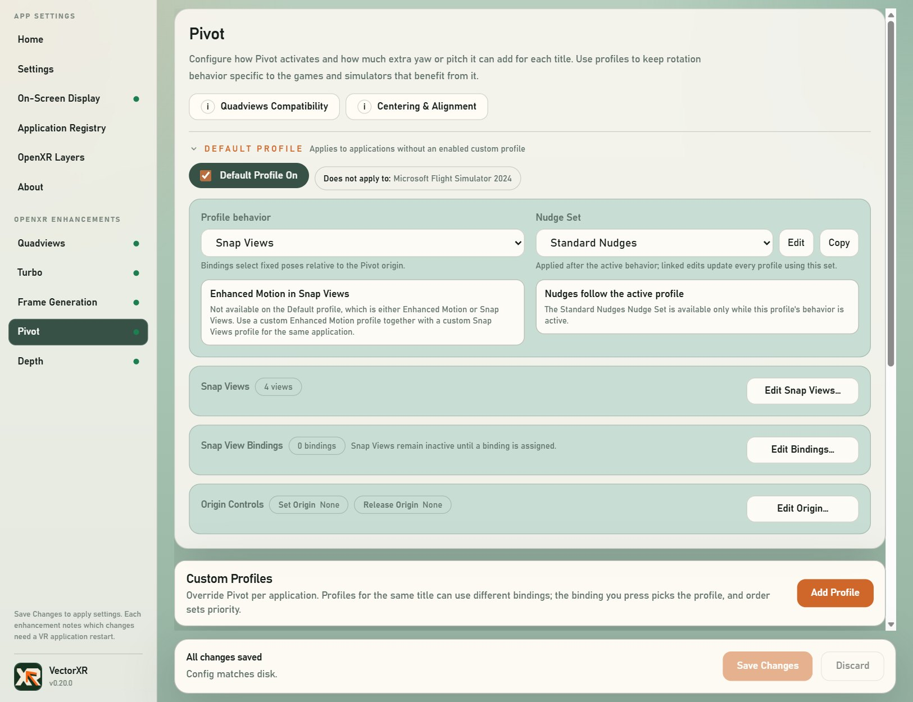

Pivot enhances head rotation for seated and flight-sim VR, letting you see further to the side or
up/down than your physical neck allows.

- Choose a **Profile behavior** for each enabled profile. **Enhanced Motion** amplifies natural
  head rotation with Continuous or Stepped response tuning. **Snap Views** uses bindings to select
  named, fixed poses relative to the captured Pivot origin.
- For **Enhanced Motion**, open **Activation** and choose an activation mode. *Toggle* and *Hold*
  require a keyboard, joystick, or HOTAS binding. *Always On* engages automatically; an optional
  activation binding suspends and resumes that automatic engagement.
- Every Pivot action accepts multiple bindings, so keyboard chords and device inputs can be mixed.
  **Origin Controls** has its own category: **Set Origin** captures the current head pose as the
  neutral seated origin; assigning it to the same input as the simulator's recenter action keeps
  both origins aligned. **Release Origin** clears that captured origin. Set Origin and Release
  Origin can each have multiple bindings too.
- Select a **Nudge Set** to layer reusable fixed-step yaw and pitch adjustments after the profile's
  main behavior. A linked set can be shared by several profiles, while **Copy** creates an
  independent starting point for different bindings or step sizes.
- Choose **Continuous** response for multiplier-based motion, then tune **Yaw** and **Pitch**
  independently with rotation **Multiplier**, **Deadzone**, and **Max Extra** degrees. A shared
  **Smoothing** value softens continuous motion.
- Choose **Stepped** response to add fixed rotation at angle thresholds. Yaw and pitch each have
  independent **Deadzone**, **Step Trigger**, **Step Amount**, **Hysteresis**, and **Max Extra**
  controls. **Instant** transitions land directly on each step; **Glide** uses one bounded,
  fixed-duration transition that settles without overshoot.
- **Advanced axes** can tune left, right, up, and down independently. Continuous and Stepped keep
  separate directional values, so switching response modes does not discard either setup.
- The **Activation Ramp** (default 0.35s) eases Pivot in and out when it engages or disengages
  rather than snapping the view.

In every Pivot mode, including Nudges and Snap Views, physical leaning follows the rotated view
at 1:1 scale. **Set Origin** supplies the fixed seated position for this movement. Without a captured
origin, Pivot uses your head position when it first engages and keeps it until fully disengaged.
Set the origin again after recentering the simulator or changing your seated position. When you
reset or recenter your view in SteamVR, Oculus, or Pimax, Pivot re-anchors its seated position
automatically, so leaning stays centered on where you now sit.

#### Setting up Snap Views

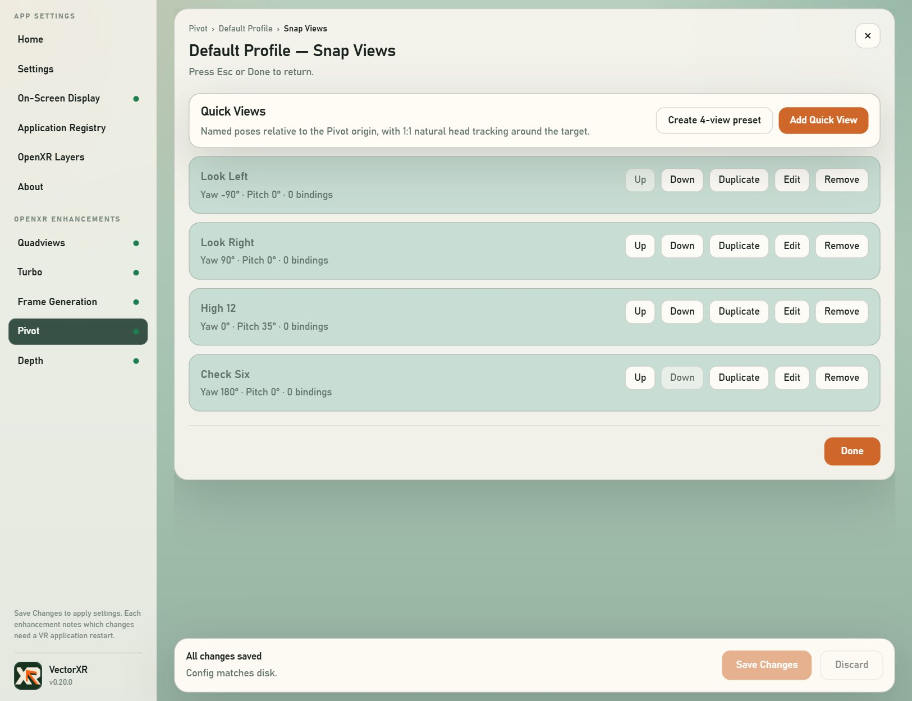

1. Enable the default Pivot profile, or add and enable a custom application profile.
2. Set **Profile behavior** to **Snap Views**, then choose **Edit Snap Views**.
3. Select **Create 4-view preset** for Look Left, Look Right, High 12, and Check Six, or use
   **Add Quick View** to build your own list.
4. Edit each view to set yaw, pitch, transition time, and optional right/left, up/down, and
   forward/back position offsets. Negative yaw turns left; positive yaw turns right.
5. Add at least one binding to every view you want to use. **Hold** returns when released;
   **Toggle** stays active until pressed again or another Snap View takes over.
6. Configure **Set Origin** under Origin Controls and align it with the simulator's recenter action.
   Snap View poses and position offsets are measured from that captured origin.
7. Save the configuration, enter VR, set the origin, and test the views from a comfortable seated
   posture. Reorder the list when binding priority or presentation order needs to be clearer.

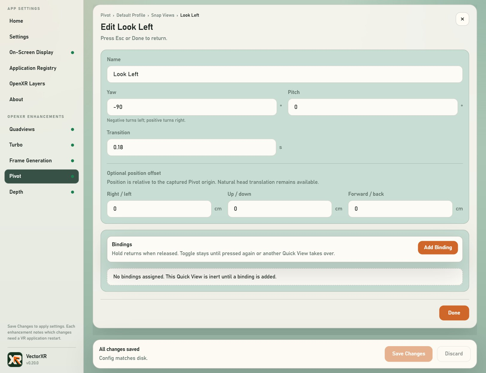

Snap Views keep natural head rotation and translation at 1:1 around the selected pose; they do not
lock the headset. A Snap View temporarily replaces Enhanced Motion and the accumulated nudge offset.
Leaving the view returns smoothly to the underlying state. A view with no binding is inert.

#### Setting up Nudges

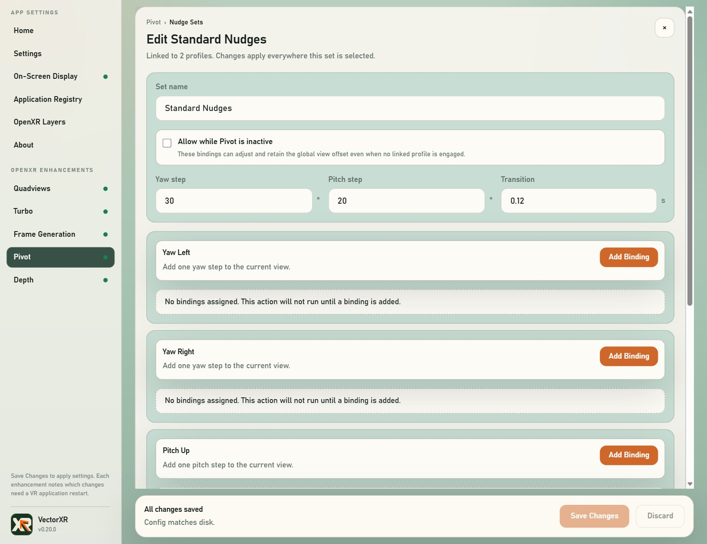

1. Select **Standard Nudges** in the profile's **Nudge Set** menu, or choose **Copy** when the
   profile needs its own steps or bindings.
2. Choose **Edit**, set the yaw step, pitch step, and transition duration, then add bindings for
   Yaw Left, Yaw Right, Pitch Up, Pitch Down, and Center Nudge Offset.
3. Leave **Allow while Pivot is inactive** off when nudges should follow the linked profile. Turn it
   on when those bindings should maintain a global view offset even with no linked profile engaged.
4. Save and test. Directional presses accumulate and oppose one another; **Center Nudge Offset**
   clears the accumulated yaw and pitch. Offsets are limited to ±180° yaw and ±85° pitch.

Editing a shared Nudge Set updates every profile linked to it. Nudges are applied after Enhanced
Motion, but a selected Snap View temporarily takes priority over the accumulated offset.

### Pivot FAQ

**Why does my Snap View do nothing?**

Enable the containing profile, give the view at least one binding, save, and confirm that the
profile targets the running application. Capture an origin before relying on position offsets.

**Should I use Hold or Toggle?**

Use **Hold** for a temporary glance that returns as soon as the control is released. Use **Toggle**
when you want to stay in the view hands-free; press it again or select another Snap View to leave.

**Does a Snap View lock my head?**

No. It moves the origin-relative target while preserving 1:1 natural head motion around it.

**Why do nudges stop when Pivot disengages?**

That is the default safety behavior. Edit the Nudge Set and enable **Allow while Pivot is inactive**
if its bindings should adjust and retain the global offset without an active linked profile.

**Should profiles share a Nudge Set?**

Share one when the same step sizes and bindings should apply everywhere. Use **Copy** before editing
when a profile needs independent controls; linked edits intentionally affect every user of a set.
Pivot and Quadviews are built to work together: because VectorXR computes both in one layer, the
foveated focus region stays locked to your gaze even while Pivot rotates your view. This
combination is VectorXR's signature capability — see [Why VectorXR](../README.md#why-vectorxr).

**Does Pivot work with MSFS 2024's built-in eye-tracked foveation?**

Yes. Pivot preserves eye direction relative to the headset so the high-resolution region
stays aligned with your gaze as the camera turns. Enable foveated rendering in MSFS 2024
and eye tracking in your headset software. MSFS handles its own foveated rendering;
VectorXR's Quadviews provider is not required for this path.

### Quadviews

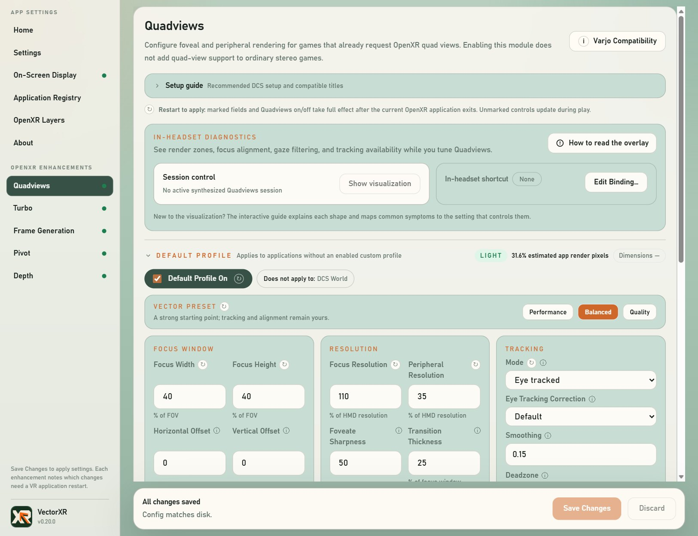

Quadviews drives foveated-style rendering, concentrating detail where you are looking. It is
marked **Experimental** and currently targets **D3D11 quadview-capable apps**. Enabling the
VectorXR module does not make an ordinary stereo game render four views: the game must request
OpenXR quad-view rendering first. DCS is the primary tested title. Other D3D11 games may work
only if they implement the same functionality; compatibility is not implied by D3D11 alone.
Likely, but unconfirmed, candidates include **Pavlov VR**, **VAIL VR**, **The 7th Guest VR**,
and **Kayak VR: Mirage**.

For the recommended **DCS + synthesized VectorXR Quadviews** path, set:

- **DCS > Options > VR > Use Quad View:** on.
- **DCS > Options > VR > Use Eye Tracking:** on for gaze-tracked focus; otherwise VectorXR can
  use head/static focus.
- **VectorXR OpenXR layer:** enabled, with a Quadviews default or DCS profile enabled and saved.
- **Pimax runtime quadviews:** off. In Pimax Play or Pimax EVO, turn **Native Pimax Quad Views**
  off so VectorXR can provide Quadviews and keep the focus region aligned with Pivot. Native Varjo
  Quadviews is different and remains runtime-driven.
- **`XR_APILAYER_MBUCCHIA_quad_views_foveated`:** disabled while VectorXR is the quadviews
  provider. Run one quadviews provider at a time.

Restart DCS after changing its VR settings, the active OpenXR runtime, or API-layer state.
The page's collapsible **Setup guide** repeats this checklist and the compatible titles; it
starts open until a Quadviews profile is enabled.

#### Live tuning and restarts

- **Fully live:** Horizontal Offset, Vertical Offset, Tracking Mode, Smoothing, Deadzone,
  Eye Tracking Correction, Foveate Sharpness, and Transition Thickness.
- **Restart required for complete effect:** Focus Width, Focus Height, Focus Resolution,
  Peripheral Resolution, and turning Quadviews or a Quadviews profile on or off. Width and height
  move the visible focus window immediately, but DCS keeps its existing texture dimensions and
  pixel workload until restart. Focus Resolution also keeps DCS's existing focus textures;
  values above 100% may resize VectorXR's output canvas and cause a temporary frame-rate hitch.

VectorXR now defers Quadviews enable/disable changes while an OpenXR session is active. Saving is
safe, but the running game keeps its launch-time state until it exits.

- **Focus Window** sets the size and offset of the high-detail region; **Resolution** sets
  **Foveate** (inner) and **Peripheral** (outer) resolution as a percentage of your headset's
  resolution (100% = headset default).
- The budget indicator at the top right estimates render cost *before* you launch — it reads as a
  **% of stereo pixels** and is color-coded, with a "Detrimental" warning when you exceed budget.
  Watch it while tuning to keep performance positive.
- **Tracking** controls eye-tracked focus (mode, smoothing, deadzone). Quadviews also depends on
  the headset runtime exposing eye-gaze support. If it does not, VectorXR falls back to
  head/static focus.

#### Eye-tracking correction and dimensions

Leave **Eye Tracking Correction** on **Default** when gaze follows your eyes correctly.
Try **Flip Z Only** if the focus region moves backwards on your setup. Save the change and
check gaze direction in the diagnostic visualization before tuning offsets or smoothing.

While a Quadviews game is running, hover the **Dimensions** indicator beside estimated
savings to see submitted peripheral and focus resolutions and allocated texture sizes.
These readings describe the current session, not previous runs or unsaved settings.
Resolution changes may require a game restart before the measured sizes change.

#### Diagnostic visualization

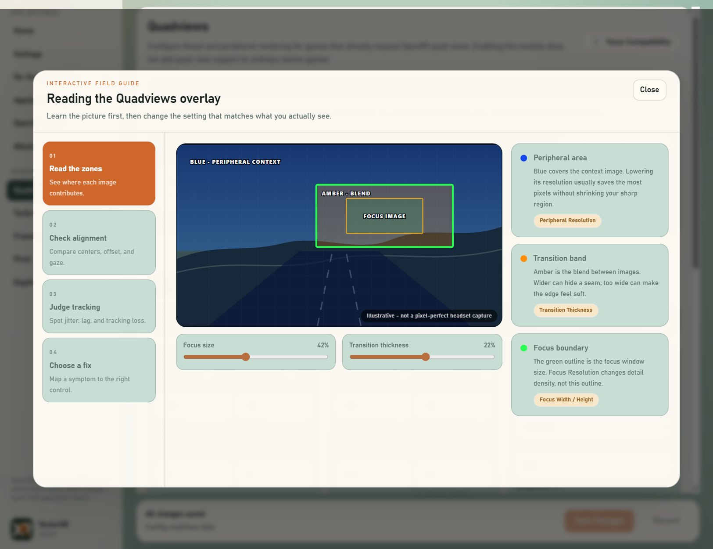

The **In-headset diagnostics** card provides two ways to control the calibration view:

- Assign an **In-headset shortcut** and press it in-game to toggle the visualization.
- While a synthesized Quadviews session is active, use **Show visualization** or **Hide
  visualization** in the VectorXR app for live control. **No active synthesized Quadviews session**
  means there is not currently a compatible session for the app to control.

The visualization starts hidden each OpenXR session. Select **How to read the overlay** for an
interactive field guide that maps the picture and common symptoms to the relevant settings. The
in-headset view labels the rendered regions and tracking pipeline with color:

- Blue tint: peripheral image; amber tint: blended transition band.
- Green focus outline: focus window with tracking available; red: eye tracking unavailable and
  VectorXR is holding or returning from the last valid gaze.
- White cross: head-forward center; magenta ring: configured horizontal/vertical offset.
- Cyan ring: raw eye gaze; yellow cross: gaze after deadzone and smoothing.

The diagnostic view is available only for VectorXR's synthesized D3D11 Quadviews compositor. It is
not currently supported on Varjo headsets, where the Varjo runtime owns native composition.

Quadviews and Pivot are designed to compose: unlike running separate foveation and neck-assist
layers, VectorXR keeps the foveated focus region aligned with your gaze while Pivot rotates the
view. See [Why VectorXR](../README.md#why-vectorxr).

### Quadviews FAQ

**Can Quadviews improve any OpenXR game?**

No. The game must request quad-view rendering. DCS is the main tested example. VectorXR's
synthesized path also requires D3D11; a D3D11 renderer by itself is not enough.

**Which quadviews provider should I enable?**

Choose one software provider. For synthesized VectorXR Quadviews, disable Quad-Views-Foveated;
on Pimax, also disable Native Pimax Quad Views. Native Varjo Quadviews remains runtime-driven. If
you deliberately use Quad-Views-Foveated instead, leave the VectorXR Quadviews profile off;
VectorXR can remain enabled for Pivot or Depth, with Quad-Views-Foveated ordered above it.

**Why is the focus region following my head instead of my eyes?**

Turn on **Use Eye Tracking** in DCS and eye tracking in the headset software. The active OpenXR
runtime must expose eye-gaze data to the layer; otherwise head/static focus is the safe fallback.

**Why does eye-tracked focus move backwards?**

Try **Eye Tracking Correction → Flip Z Only** in the matching Quadviews profile.
This changes how backwards-facing driver gaze rays are corrected. **Default**
preserves the existing behavior; leave it selected when gaze movement is correct.

**Why did a saved setting appear to do nothing?**

Confirm that the game has Quad Views enabled, the correct VectorXR profile matches its executable,
and only one provider is active. Check whether the control is marked **Restart required**.
API-layer, runtime, and in-game VR changes also require a full game restart.

**Why is Show visualization unavailable?**

Live app control requires an active VectorXR synthesized D3D11 Quadviews session. Start a compatible
quad-view application with the VectorXR profile enabled. Native Varjo composition does not expose
this visualization; the saved in-headset shortcut also begins each new session with the overlay off.
**What else should I disable while troubleshooting?**

Avoid overlapping features: DCS **Force IPD Distance** can mask Depth, another tool's Turbo mode
can conflict with VectorXR Turbo, and runtime-native quadviews such as Pimax's does not currently compose with Pivot.
Re-enable extras one at a time after the base setup works.

### Turbo

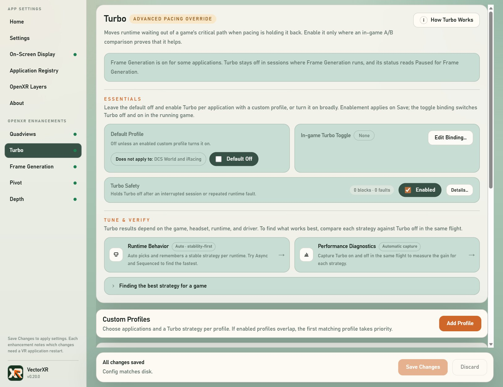

Turbo is an opt-in frame-pacing override for games whose main thread is being held back by the
OpenXR runtime's wait behavior. It is compatibility-sensitive, so keep the default profile off
and enable it only for applications where an in-headset A/B comparison demonstrates a benefit.

#### Set up Turbo for a game

1. Register the game's executable in **Application Registry**.
2. On **Turbo**, leave **Default Profile** off and add an enabled **Custom Profile** for
   that application. Default On applies Turbo to applications without a custom profile.
3. Keep **Turbo Safety** enabled. Open **Runtime Behavior** and start with **Mode** on
   **Auto · stability-first**. Auto picks a stable strategy, not necessarily the fastest one.
4. Use **In-game Turbo Toggle > Edit Binding…** to assign a keyboard or controller control,
   then click **Save Changes**. The binding works only where Turbo is enabled in the
   application's profile; it can also retry after a safety block or suspension.
5. Launch the game and compare Turbo on/off in the same scene. Use **Performance Diagnostics**
   to compare FPS, frame times, and pacing waits alongside what you see in the headset.

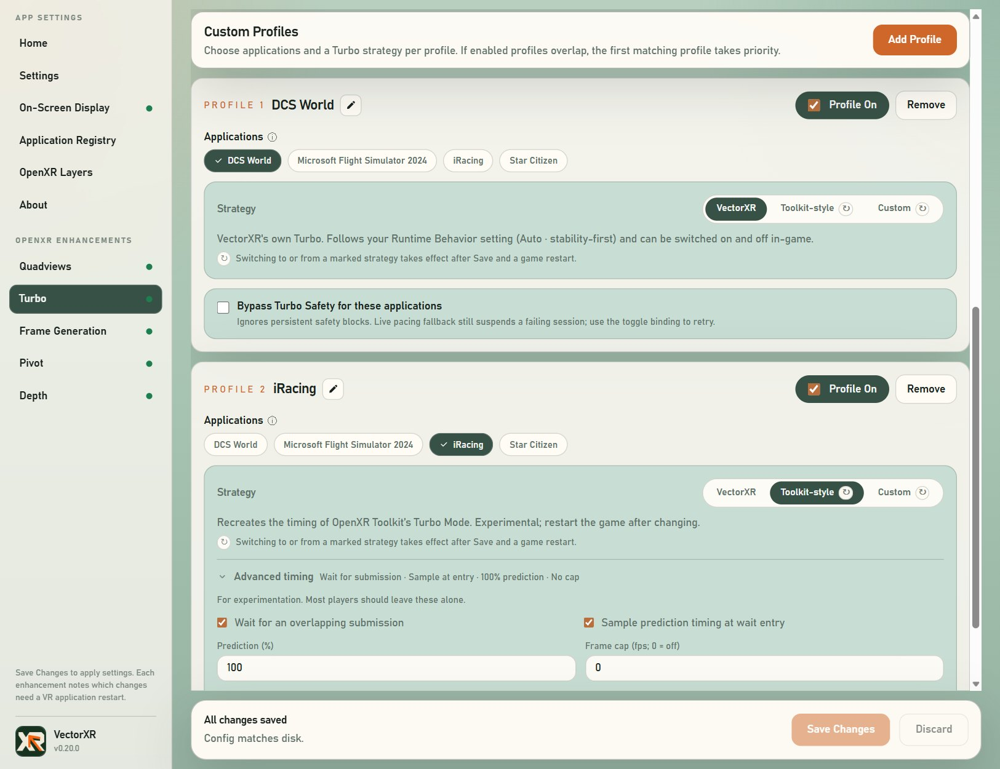

Each custom profile has a **Strategy**: **VectorXR** (VectorXR's own Turbo, following Runtime
Behavior), **Toolkit-style** (recreates the timing of OpenXR Toolkit's Turbo Mode), or **Custom**
(Toolkit-style with your own values under **Advanced timing**). Toolkit-style and Custom are
experimental and take effect after a game restart. The profile's application assignments also
scope its strategy; there is no separate experiment application picker. See
[Turbo timing experiments](turbo-experiments.md) for what each advanced control changes.

To find the best strategy for a game, test one strategy per launch. In each flight, capture Turbo
on and Turbo off with the in-game toggle, then compare the gain in **Performance Diagnostics**,
which labels each flight with the strategy it used. Try Async and Sequenced in Runtime Behavior,
then Toolkit-style, and keep the one with the best gain and 1% lows and no stalls.
The first matching enabled profile takes priority. To compare profiles for the same game, enable
the intended profile, save, and relaunch the game. Timing remains fixed for that VR session.
Timing experiments saved by pre-release 0.18 builds migrate into the matching custom profiles;
unassigned timing is offered as **Use saved timing in this profile** and is not applied to any
game until selected and saved.

Do not combine VectorXR Turbo with another pacing override such as OpenXR Toolkit Turbo Mode.
VectorXR [Frame Generation](#frame-generation-experimental) also takes over pacing: Turbo stays
off in sessions where it runs.
Turn Turbo off if you see a Waiting overlay, black frames, persistent stutter, or broken
reprojection. A mid-session toggle can briefly hitch while timing resynchronizes.

Turbo enablement can apply after **Save Changes** while an OpenXR application is already
running, provided the VectorXR layer was loaded at launch. The in-game binding switches
between off and the active pacing strategy. Live enablement followed by repeated
off/Async toggles has been observed in DCS; this does not establish compatibility for
every game/runtime combination. Experimental timing settings are latched at session
start and still require a relaunch. Quadviews activation also requires a relaunch.

After Turbo establishes a frame pipeline, switching it off with the in-game toggle restores
runtime-paced application waits while preserving ownership of the pending frames, so
switching it back on resumes immediately. This applies to both Async and Sequenced pacing
and avoids unmatched begin/end calls during a live toggle. If Turbo Safety suspends Turbo,
Turbo is disabled in settings, or the runtime stalls while Turbo is off, an Async pipeline
instead hands its frames to pacing on the game's own frame thread for the rest of the
session; the next launch starts from your configured strategy again. An off interval in the
same session measures re-coupled pacing; use a fresh session with Turbo disabled to compare
against a session in which Turbo never established a pipeline.

#### Runtime Behavior

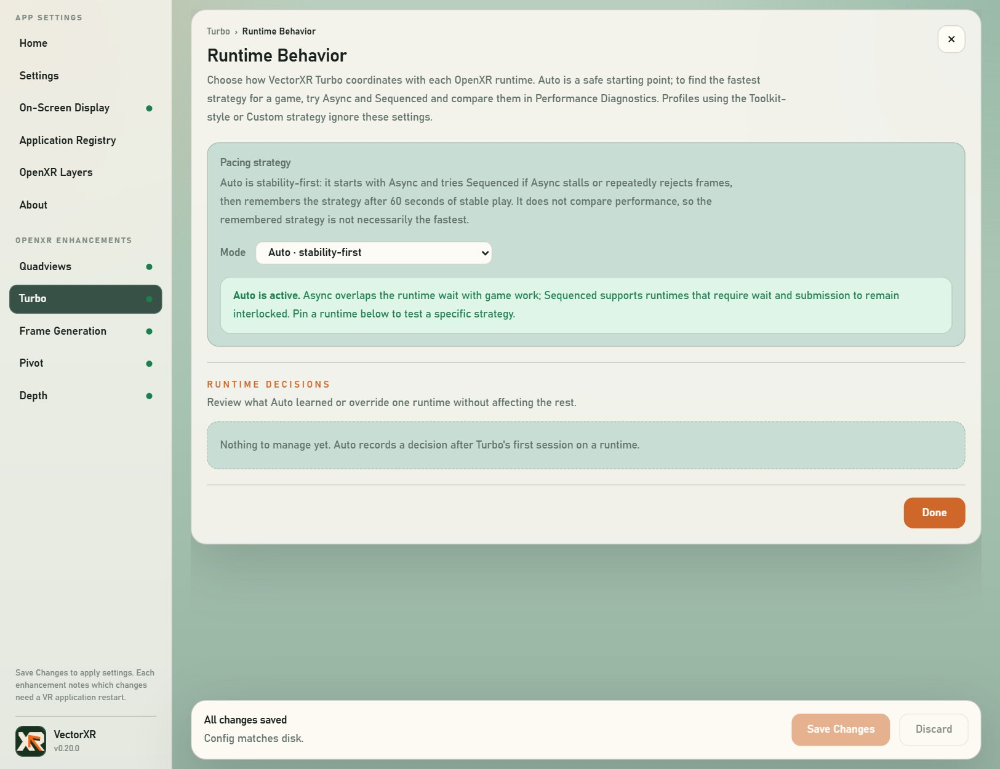

**Auto** starts with **Async**, which overlaps the runtime wait with game work. If Async
stalls or repeatedly rejects frames, Auto tries **Sequenced**, which supports runtimes
that need waiting and submission to remain together. A strategy is remembered after
**60 seconds of stable play**. There are no built-in runtime/headset strategy mappings.

**Runtime Decisions** shows learned results and per-runtime overrides. Leave overrides
on Auto for discovery; forced Async or Sequenced and manual runtime pins take precedence.
A full strategy retest needs a relaunch in Auto without a manual override. An established
Sequenced session keeps that strategy until relaunch even if you change the setting.

#### SteamVR activation in 0.17

The previous VectorXR activation restriction for **DCS + SteamVR + synthesized Quadviews**
has been removed. This setup can now engage Turbo and use the same Auto strategy selection
and Safety controls as other setups.

This removes an application/runtime restriction, not a runtime-enforced FPS cap. Turbo
still depends on the game, headset, driver, and runtime. Disable **SteamVR Motion Smoothing**
when testing and compare both frame times and presentation. Other reprojection systems,
including ASW, may also conflict with Turbo's timing.

#### Turbo Safety

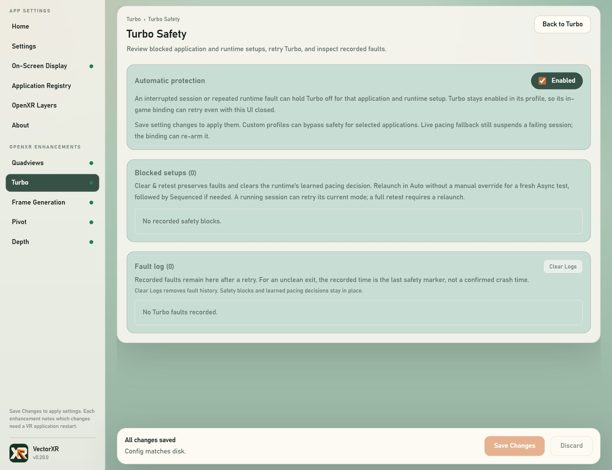

Open **Details…** on the Turbo page's **Turbo Safety** card (**Review…** when setups are
blocked). The **Enabled/Disabled** switch appears both on that card and under **Automatic
protection** on the Safety page; both edit the same global setting. Protection is enabled by default. Click **Save Changes** after changing it.

An interrupted session or repeated runtime fault can hold Turbo off for the same application
and runtime setup, including its headset and graphics configuration. Turbo remains enabled
in the profile so the in-game binding can retry it. A forced exit or unrelated crash can
also leave an interrupted-session record; a block does not prove Turbo caused a crash.

The page shows live Turbo status when a game is running, **Blocked setups**, and a separate
**Fault log**. The overview's block/fault counts describe recorded history, not whether Turbo
is currently rendering frames. A block marked **Bypassed** is retained but is not enforced
by the saved global or per-profile Safety settings.

| Control | What it changes |
| --- | --- |
| In-game Turbo toggle | Retries Turbo for the running application after a block or suspension. A full strategy retest still requires relaunching. |
| **Details** | Opens the fault reason, recorded time, pacing mode, runtime, headset, graphics API, and process ID where available. |
| **Clear & retest** | Clears the selected setup's block and its runtime's learned pacing decision, while retaining fault history. Relaunch in Auto without a manual override to test Async and then Sequenced if needed. |
| **Clear Logs** | Removes recorded fault history. It does **not** clear safety blocks or learned pacing decisions. The button is disabled when there are no faults. |
| Global **Turbo Safety: Disabled** | Bypasses persistent protection, including previous blocks. Live pacing fallback can still suspend a failing session. Save to apply. |

Retry only after the session is stable. If the game is stuck, close and relaunch it;
Safety cannot unblock a driver call already in flight.

#### Per-application Safety override

For an application-specific exception, open its custom Turbo profile and check
**Bypass Turbo Safety for these applications**, then **Save Changes** (see the profile
screenshot above). Leave this unchecked to use the global protection setting. The bypass
applies only to that profile's applications; it does not turn off live pacing fallback or
delete history.

#### Fault logs and support exports

Faults remain available after a retry. For an unclean exit, the recorded timestamp is the
last Safety marker, not a confirmed crash time. The Turbo Safety screenshot shows an empty
**Fault log**; recorded faults add rows with **Details** controls.

Before clearing logs, use **Home > Export Debug** to save an **Export Debug Information** ZIP
when reporting a problem. It includes Turbo metrics, pacing decisions, safety records,
live and saved runtime diagnostics, current and saved settings, and retained VectorXR logs.
Raw capture is limited to 8 MiB per file and 64 MiB total; the ZIP inventory lists any
unavailable or limited files. Review the ZIP for private information before sharing it.

### Frame Generation (experimental)

Frame Generation holds a game at half your headset's refresh rate or lower, for example 45 fps
on a 90 Hz headset, and inserts generated frames between real frames. The headset still
receives a full-rate image stream while the game renders only a fraction of it. The
[Frame multiplier](#frame-multiplier) sets that fraction: 2x, 3x, 4x, or Auto.

Generated frames come from GPU optical flow measured on the final color images the game
submits. VectorXR removes your head rotation from the flow before matching, because the
runtime's own reprojection already handles head rotation, so the flow follows world,
vehicle, and object motion. The approach is inspired by
[OFXR-Bridge](https://github.com/tig3rmast3r/OFXR-Bridge).

Frame Generation is experimental. Keep the Default Profile off and enable it per game after
comparing it in the headset.

#### Set up Frame Generation for a game

1. Turn off runtime smoothing for the game: **SteamVR Motion Smoothing**, **Pimax Smart
   Smoothing**, **Virtual Desktop SSW**, or **Meta ASW**. They fight Frame Generation's pacing.
2. Keep the runtime at full refresh. Do not halve the frame rate in **Pimax Play** or with a
   SteamVR fixed 45 fps setting: Frame Generation lowers the game's rate itself and needs the
   headset running at its full refresh rate.
3. Register the game's executable in **Application Registry**.
4. On **Frame Generation**, leave **Default Profile** off, click **Add Profile**, and assign the
   game. An enabled matching custom profile turns Frame Generation on for that game even when
   the Default Profile is off.
5. Start with the default settings (**Synthesis mode: Interpolate**, **Frame multiplier: Auto**),
   then click **Save Changes**. For very heavy games, such as MSFS at very high resolution, start
   with **Extrapolate** and **3x**, **4x**, or **Auto** instead.
6. Restart the game. Turning Frame Generation on, for the Default Profile or a custom profile,
   takes effect at the next launch. Turning it off applies to a running game at once: frames
   pass straight through.
7. Confirm it is running: turn on the **Frame Generation state** row on the **On-Screen
   Display** page, or set **Diagnostic view** to **Generated-frame tint**.
8. Optional: use **A/B toggle > Edit Binding…** to assign a keyboard or controller input, then
   switch generated frames off and on in the same scene to compare.

Frame Generation engages a few seconds after the game starts rendering steadily. Loading
screens and other frames without a rendered image pass straight through, and generation
resumes once the game renders steadily again. If the runtime rejects a generated frame, the
GPU work fails repeatedly, or the game keeps starting frames before the previous one ends,
Frame Generation pauses. It retries by itself after a few seconds, up to three times per
session, and the A/B toggle retries at any time. **Unavailable** means the session cannot generate frames at all, for example
because the game renders into multisampled or unusual swapchain formats; the reason appears in
the OSD and in the live status.

The page's collapsible **Setup guide** repeats this checklist; it starts open until a Frame
Generation profile is enabled. **In-headset controls** lists running VR applications with
their live Frame Generation status. **Needs the updated VectorXR layer** means the running
layer predates Frame Generation.

#### Interpolate or Extrapolate

| Mode | How it works | Trade-off |
| --- | --- | --- |
| **Interpolate** (default) | Blends generated frames between the previous and the newest real frame. | Fewest artifacts, and the closest match to OFXR-Bridge. Each real frame is shown after the generated frames leading up to it, so everything appears one real frame interval later (about 33 ms at 4x, 22 ms at 3x); head rotation is still corrected by the headset. |
| **Extrapolate** | Pushes the newest real frame forward along its motion, like ASW or Smart Smoothing. | No added latency. More edge artifacts on fast motion and in newly revealed areas, and fine cockpit detail depends more on the game's depth (see Game depth). |

On Direct3D 12 both modes present from their own thread: a frame every refresh while the game
renders at its own pace, as it would without Frame Generation. With Direct3D 11 and Vulkan, the
game's frame thread presents the generated frames itself before it can start the next frame.
That works when the game finishes each frame well within the time the runtime gives it, but a
game whose frame takes longer, or that starts its next frame before ending the current one,
loses frame rate instead of gaining it. **Auto** detects this and holds full rate for a minute
before trying again (turning Frame Generation off and on retries at once); the log says so.

#### Game depth

When a game sends depth to the headset, Frame Generation uses it on Direct3D 12 automatically.
MSFS 2024 only fills the depth it sends while its **Motion reprojection** setting is **Depth**;
with it off, the depth is empty and Frame Generation does without. With depth, head movement is
compensated exactly, so cockpit instruments, panels and text stay still in generated frames
instead of wobbling. Generated frames also show the
cockpit from where your eyes will be when each frame is displayed, as the runtime predicts it.
Most headset runtimes only correct head rotation between frames, so without this, near cockpit
detail would jump at the game's frame rate whenever your head moved. Direct3D 11 and Vulkan games
use head rotation only for now.

Games do not always describe their depth correctly, so Frame Generation first checks it against
the other eye: depth that is right lines the two eyes' images up. It starts using depth once
that check passes, recognizes depth stored the other way round, and ignores depth that does not
line the eyes up. Where the other eye or the previous frame disproves depth in places, for
example cockpit glass the game wrote to depth over the scenery behind it, those places are
treated as far away, and do not move with your eyes. The log reports each
decision (**Frame Generation checked the game's depth against the other eye**), how much of the
view the depth affects and how much of it the other eye disproved. Each 30-second summary shows
**depthUsed**, the share of real frames generated with depth, and **eyeShiftMm**, how far
generated frames moved with your eyes (average/largest, millimeters).

The OSD's Frame Generation line and the Frame Generation page's session status say what the
depth is doing: **Depth in use**, **Checking the game's depth**, **No depth from this game**
(near cockpit detail may jitter in Extrapolate; Interpolate depends on depth less), **Depth not
read on this graphics API yet** (Direct3D 11 and Vulkan), **Depth empty** (the game sends depth
but fills it only with its own depth reprojection on), or **does not match the other eye**.

#### Still detail

In Extrapolate, motion is only pushed forward where it continues the motion of the previous
pair of real frames. Fine still detail such as instrument faces and text shimmers slightly from
frame to frame under anti-aliasing and upscaling, and motion estimation reads that as motion
that changes every frame; extrapolating it would make still cockpit detail jitter. Steady
motion, including after a real frame arrives late, is extrapolated as before.

#### Frame multiplier

The **Frame multiplier** sets how many headset frames each real game frame covers:

| Multiplier | Game rate | Example at 90 Hz | Generated frames between real frames |
| --- | --- | --- | --- |
| **2x** | 1/2 of the headset refresh rate | 45 fps | One |
| **3x** | 1/3 | 30 fps | Two |
| **4x** | 1/4 | 22.5 fps | Three |

**Auto** (default) starts at full rate: while the game holds the headset refresh, frames pass
straight through and the status reads **Full rate**. When it cannot, Auto steps up to 2x, 3x or
4x, and steps back down when it can, checking now and then whether a lower multiplier holds.
Output images, once allocated, are kept for the session, so changing multiplier never stalls
the game.

Higher multipliers rescue very heavy games, such as MSFS at very high resolution, but each
generated frame moves content further, so artifacts grow; 4x shows the most. Each generated frame
also needs its own set of headset-resolution output images, and in Extrapolate on Direct3D 12 one
spare set covers a game frame that arrives late (up to three sets), so video memory use grows
with the multiplier. The log reports the estimate.

#### Frame Generation settings

Every setting below applies live after **Save Changes**. Only turning Frame Generation on
needs a game restart; turning it off applies at once.

- **Frame multiplier** (**Auto**, **2x**, **3x**, or **4x**; default Auto) sets how many headset
  frames each real game frame covers. See [Frame multiplier](#frame-multiplier).
- **Flow quality** sets the resolution motion is measured at: **Performance** (1/16 of the eye
  image), **Balanced** (1/8, default), or **Quality** (1/4). Higher quality tracks small and
  thin objects better and costs more GPU time.
- **Motion estimation** (experimental): **Shader** (default) measures motion by block matching
  on the GPU's shader cores, on any GPU. **NVIDIA hardware** uses the optical flow accelerator of
  NVIDIA RTX 20-50 GPUs in Direct3D 12 games such as MSFS, at 1/8 of the eye image. Repeating
  patterns such as building windows and railings no longer lock onto the wrong repeat. The
  accelerator starts on each eye's image as soon as the game releases it, so it mostly runs
  while the game finishes its frame (about 7 ms of accelerator time at a Pimax Crystal Super's
  resolution). With **Performance** flow quality it uses the accelerator's fastest preset, which
  is less accurate on repeating patterns. Elsewhere Shader is used, and the log says why. In
  `settings.json`, set `"motionEstimation": "hardware"` in a profile's settings.
- **Artifact suppression** (0–100, default 50): higher values fall back to the real image
  sooner where motion is uncertain. You get fewer warping artifacts and more local judder.
- **Motion limit** (2–25% of view width, default 10%) is the farthest a generated frame may
  move image content. Motion beyond it falls back to the real image.
- **Diagnostic view** applies to every Frame Generation session: **Off**, **Motion flow**
  (color-coded motion overlay on generated frames), **Confidence** (heat map of where
  generation fell back to the real image), or **Generated-frame tint** (a faint tint on
  generated frames, so you can confirm they are being shown).
- **A/B toggle** is an optional binding that switches generated frames off and on live. It only
  works in sessions that started with Frame Generation on.

The Default Profile and each custom profile have their own Synthesis mode, Frame multiplier,
Flow quality, Artifact suppression, and Motion limit. The first enabled custom profile that matches the
running game wins.

#### How Frame Generation works with other features

- **Turbo:** Turbo and Frame Generation have opposite pacing goals. In a session where Frame
  Generation runs, Turbo stays off and its status reads **Paused for Frame Generation**. Your
  Turbo profiles are not changed. The Turbo and Frame Generation pages show a notice when an
  application has both turned on; it never blocks saving.
- **Quadviews:** works with VectorXR's synthesized quad views and with Varjo-native quad views,
  because generation runs on the final images sent to the headset.
- **Graphics APIs:** Direct3D 11, Direct3D 12, and Vulkan.
- **On-Screen Display:** the expanded layout has a Frame Generation row, shown only in games
  where Frame Generation is on, and the compact layout an optional one-line status. See
  [On-Screen Display](#on-screen-display).
- **Runtime smoothing:** SteamVR Motion Smoothing, Pimax Smart Smoothing, Virtual Desktop SSW,
  and Meta ASW fight the pacing. Turn them off for games that use Frame Generation.
- **Runtime frame rate:** keep the headset at its full refresh rate. Do not halve the frame rate
  in Pimax Play or with a SteamVR fixed 45 fps setting; Frame Generation lowers the game's rate
  itself.

#### Current limits

- Frame Generation does not use game motion vectors yet; motion is estimated from color
  images, with the game's depth (Direct3D 12) used only to remove head movement.
- There is no HUD masking yet. Cockpit text and gauges baked into the 3D image can shimmer on
  generated frames.
- Fast motion and newly revealed areas can warp, more so with Extrapolate. Raise **Artifact
  suppression** or lower **Motion limit** to trade warping for local judder.
- The game needs enough GPU headroom to hold its multiplier's rate (half rate at 2x) plus the
  Frame Generation work. On an RTX 5090 at a Pimax Crystal Super's 6240x6280 per eye, 4x
  Extrapolate on Direct3D 12 takes about 3.1 ms per real frame at Balanced flow quality and
  3.8 ms at Quality, for both eyes; slower GPUs and Direct3D 11 and Vulkan take more.
- Higher multipliers show more artifacts, most at 4x, and in Extrapolate each generated frame
  adds a set of headset-resolution output images to video memory.
- Only the first projection layer is generated; other layers, such as menus drawn as quads,
  repeat unchanged. Generated frames keep the real frame's depth for the runtime.

### Frame Generation FAQ

**Why does the game now run at 45 fps or lower?**

That is expected. Frame Generation holds the game at half the headset refresh rate or lower and
fills in the frames between: 45, 30, or 22.5 fps on a 90 Hz headset at 2x, 3x, or 4x. With
**Auto**, the rate changes as the game gets lighter or heavier. Judge the image in the headset,
not the game's own FPS counter.

**Which frame multiplier should I use?**

Start with Auto. For very heavy games, such as MSFS at very high resolution, use Extrapolate with
3x, 4x, or Auto. Each step up adds artifacts, and 4x shows the most, so use the lowest
multiplier the game can hold.

**I saved, but nothing changed in the running game. Why?**

Turning Frame Generation on takes effect at the next launch. Restart the game, and
confirm the enabled profile targets the running executable. Other settings apply live.

**Why does the A/B toggle do nothing?**

The toggle only works in sessions that started with Frame Generation on for that game. Turn it
on, save, restart the game, then use the binding.

**Should I use Interpolate or Extrapolate?**

Interpolate has the fewest artifacts and adds about one real frame interval of latency;
Extrapolate adds none and has more artifacts. On Direct3D 12 (MSFS) both present from their own
thread; with Direct3D 11 and Vulkan, prefer Extrapolate for games that cannot hold full rate.

**Why do cockpit gauges and text shimmer?**

HUD masking is not available yet, so text and gauges in the 3D image can wobble on generated
frames. Raising Artifact suppression can help.

**Can I use Turbo with Frame Generation?**

Not in the same session. Frame Generation takes over frame pacing, so Turbo stays off wherever
Frame Generation runs. Turbo still works for games without Frame Generation.

**Do I need to turn off Motion Smoothing or ASW?**

Yes. Runtime smoothing (SteamVR Motion Smoothing, Pimax Smart Smoothing, Virtual Desktop SSW,
Meta ASW) fights Frame Generation's pacing. Also keep the runtime at full refresh: do not halve
the frame rate in Pimax Play or with a SteamVR fixed 45 fps setting.

## On-Screen Display

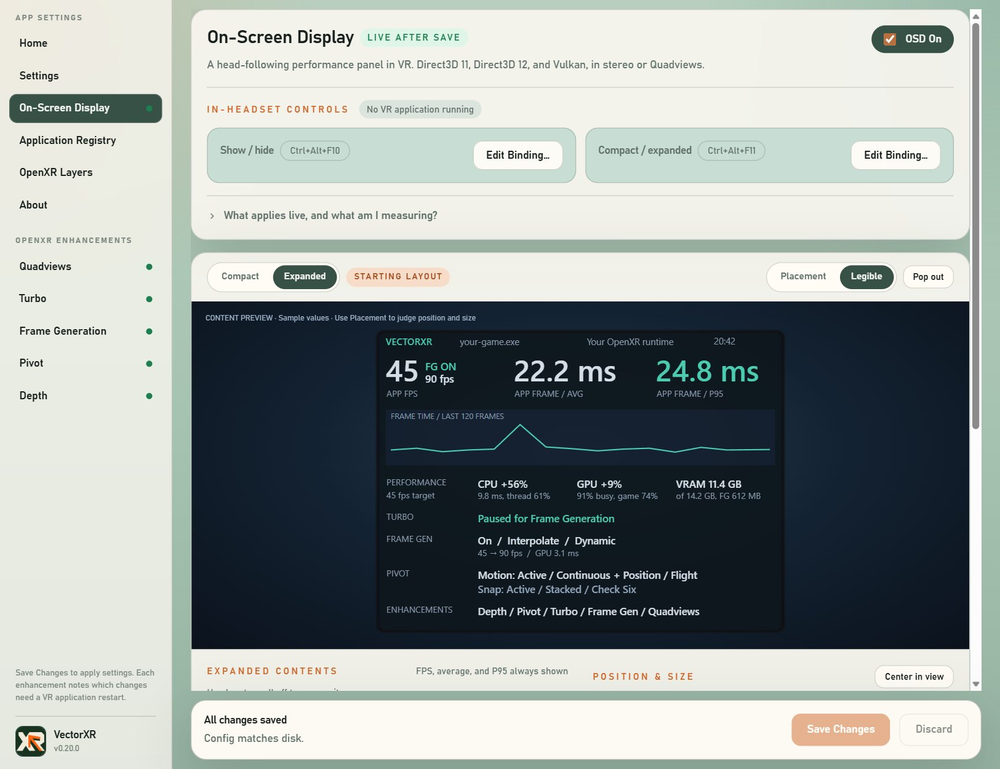

The **On-Screen Display** page adds a head-following information panel inside Direct3D 11,
Direct3D 12, and Vulkan OpenXR applications. It works with stereo and Quadviews submissions
and is off by default. VectorXR must be registered and loaded by the application; relaunch
the application after updating the layer DLL.

1. Open **On-Screen Display** and switch **OSD Off** to **OSD On**.
2. Pick a starting point under **Presets** at the bottom of the page: **Expanded**,
   **Performance**, or **Minimal**.
3. Choose **Compact** or **Expanded** above the preview to edit that layout. The layout the
   panel opens in each session is marked **Starting layout**; while editing the other one,
   **Start in Compact** or **Start in Expanded** makes it the starting layout.
4. With **Placement** selected, drag the panel in the preview or use the **Horizontal** and
   **Vertical** sliders. Positive horizontal angles move right; positive vertical angles move
   up. **Center in view** returns it to the middle.
5. Choose contents, size, opacity, refresh rate, accent, and viewing distance, then
   **Save Changes**.
6. In the game, press **Ctrl+Alt+F10** to show or hide the display and **Ctrl+Alt+F11** to
   switch between the compact and expanded layouts. Both bindings can be reassigned to
   keyboard chords, joystick buttons, or hat directions, with optional sound feedback.

The preview has two views. **Placement** shows the panel's angular size and position in a
100° × 80° reference view; actual headset field of view varies. **Legible** enlarges the
panel with sample values so you can check its contents, at one shared scale for both layouts.
**Pop out** opens a resizable preview window that stays above the desktop app and reflects
unsaved changes. Dragging the panel there also updates the position controls. Closing the
window restores the embedded preview; leaving the OSD page closes the pop-out. The **Custom**
accent button selects your custom color and opens or closes its picker.

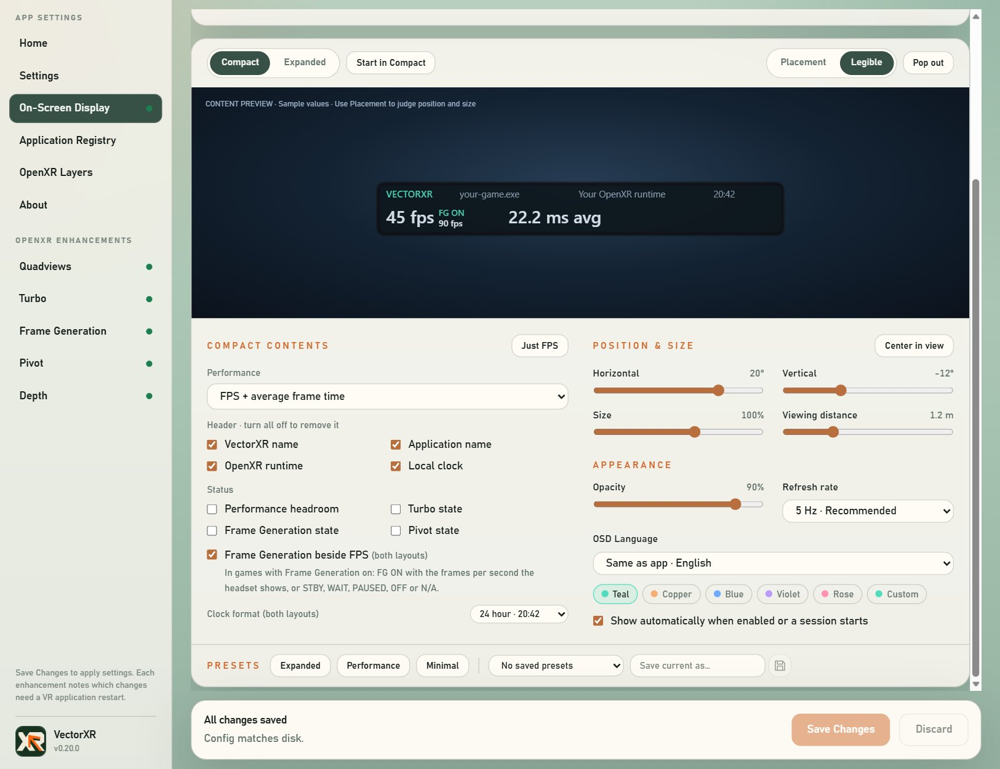

Every setting on this page applies live after Save, including enabling the OSD in an
already running application. Visibility and layout changes made with bindings last for
the current session; the next session uses the saved starting settings. Changing the
automatic visibility option also updates visibility in the current session. The OSD
can remain visible when the VectorXR enhancement master switch is off; disable it on
its own page when you want no overlay.

Both layouts keep a fixed header order: VectorXR, application name, OpenXR runtime, and
local clock. Each header item can be turned off, and turning all of them off removes the
header. Choose 12-hour (with AM/PM) or 24-hour time. Long application and runtime names are
truncated within their own fields.

The **Expanded** layout always shows application FPS, average application frame interval,
and P95, and adds selectable rows for the frame-time graph, Turbo, Frame Generation, Pivot,
and active enhancements. Drag these rows or use their up/down arrows to arrange them. Saved
layouts from earlier versions gain the Frame Generation row at the end. The **Compact**
layout chooses its **Performance** readout (FPS and average frame time, either one, or
none) and can add one-line Turbo, Frame Generation, and Pivot status rows. **Just FPS** clears the compact
header and status rows for the smallest display. Turbo distinguishes **Disabled**, **Enabled / Off**, **Enabled / Waiting**, active
**Async** or **Sequenced**, and safety states. Frame Generation shows its mode, multiplier,
and frame rates, such as `Extrapolate 3x / 30 -> 90 fps / 3.1 ms` (`Auto 3x` with Auto, or
**Full rate** when Auto needs no generated frames), or a status such as **Waiting for steady
frames**, **Paused**, or **Unavailable** with a reason. Enabled enhancements include Turbo even
when its binding has switched pacing off. Pivot shows the engaged profile and applied
nudges/quick views without angle measurements; idle enabled Pivot reads **Pivot ready**.
Disabling Pivot clears its applied-state display. Independently enabled inactive nudges
remain reported while their offset is still applied.

Size ranges from **25–150%**. Choose Teal, Copper, Blue, Violet, Rose, or a custom accent
using the color wheel, brightness slider, native color picker, or hex field. Presets
set placement, appearance, header options, and body contents together. To keep a custom
layout, enter a name and click the save icon, then **Save Changes**. Reusing a name updates
that preset. Select a saved preset to load it; **Load** reapplies the selected preset after
edits. The trash icon removes the selected preset; **Save Changes** persists the deletion.
Presets do not change enablement, startup visibility, or bindings, and travel with the
saved configuration rather than becoming application profiles.

Pending changes to Turbo experiments or Quadviews activation appear as a restart notice
in the expanded layout. Other settings retain the live/restart behavior described on
their respective pages; this notice is not an exhaustive list of every restart-sensitive
setting. Settings editing remains in the desktop app.

**What the numbers mean:** the OSD samples the time between application `xrEndFrame`
calls over the last 120 frames. FPS is calculated from the average interval; P95 is
the 95th-percentile interval. Lower, steadier frame times generally indicate smoother
application cadence. These numbers do not measure GPU execution, compositor FPS, or
reprojection. Turbo can make application cadence differ from the headset refresh rate.
Pauses longer than one second reset the history.

Panel refresh is independent of frame sampling. The default **5 Hz** redraw rate keeps
the information readable without updating the text every frame; 1–20 Hz is available.
Drawing runs on a background worker. The panel normally occupies its own composition layer,
so it stays independent of application resolution and foveation. In VectorXR's synthesized
D3D11 Quadviews sessions it is drawn into the combined eye images instead. Viewing distance
changes its stereo depth while preserving its apparent size. The panel follows the headset,
not the world, and does not appear in every game's desktop mirror. If a refresh cannot
finish in the current frame, the previous panel image stays on screen until it does.

**Compatibility:** the OSD requires a D3D11, D3D12, or Vulkan session and a runtime-provided sRGB swapchain
format. Both Vulkan OpenXR bindings (`XR_KHR_vulkan_enable` and `enable2`) are supported. OpenGL is not supported. The panel is omitted while the
runtime requests no rendering, on empty submissions, or when the application uses every
available composition layer. The **VR session** area reports availability and errors.
Frame-order or timestamp rejections preserve the OSD for subsequent frames; no failed
frame is submitted twice. If an overlay resource or layer fails, disable and re-enable
the OSD to retry. Logs count transient frame rejections separately from overlay failures.

OSD diagnostics are included in **Export Debug** through the session logs. Normal logging records
initialization, graphics backend, resource configuration, layout/visibility changes, failures and
30-second summaries (plus a final teardown summary). Summaries separate disabled, hidden and
visible periods and include preparation/append CPU elapsed time, application cadence, downstream
submission time, refresh counts, skipped frames, image timeouts and upload deferrals. Debug logging
adds worker rasterization, acquire/wait/release, upload enqueue and image-age timing distributions.
It also records the first raster's four edge strips and transparent guard check on the
raster worker. These describe the source pixels, before runtime composition and lens
correction, and help investigate colored edges. Startup logs identify the compiled layer build.
P95 values are histogram upper estimates (0.05 ms buckets below 10 ms, 2 ms buckets below 120 ms;
overflow uses the observed maximum). These CPU-side measurements do not measure GPU execution
or compositor cost. Compare the same scene/settings/log level across disabled and visible periods;
hiding the OSD keeps monitoring active. No per-frame file logging is added.

The Turbo row adds **Analyzing** while performance collection is active, including when Turbo
is toggled off for a baseline. The current pacing state and experimental indicator remain visible.
Pausing collection queues the complete captured data with its live status cleared, even
if an earlier periodic save is still running. Resuming retains the same capture and
excludes the paused interval. File writes run in the background.

## OpenXR layer management

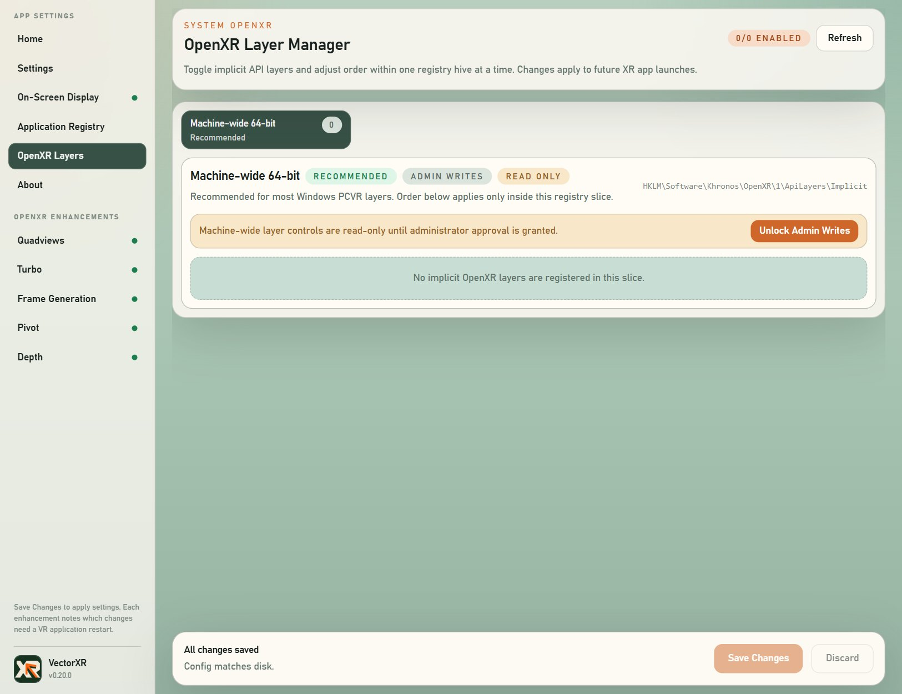

The **OpenXR Layers** tab manages the implicit API layers installed on your system across the
four Windows registry slices (Machine-wide / Per-user × 64-bit / 32-bit — *Machine-wide 64-bit*
is the recommended one for most PCVR). For each layer you can see its name, path, and signature
status, and you can enable, disable, reorder, or remove its registry registration.
Signature verification is optional: Refresh on this page requests it, with a
four-second limit per binary; startup readiness does not wait for verification. Removal asks
for confirmation and does not delete the layer's files from disk.

Machine-wide slices are read-only until you choose **Unlock Admin Writes**, which asks Windows
for administrator approval. When VectorXR itself is running as administrator, machine-wide
slices are already unlocked and changes apply without an extra prompt.

**Provider and order both matter.** When VectorXR provides Quadviews, disable
**Quad-Views-Foveated** so the two layers do not compete. If you intentionally use
Quad-Views-Foveated with VectorXR Pivot instead, keep the VectorXR Quadviews profile off and order
Quad-Views-Foveated **above VectorXR**. Official release builds are signed by **DienerTech LLC**;
local source builds may be unsigned. Signature status is shown after requesting verification.

## Updates

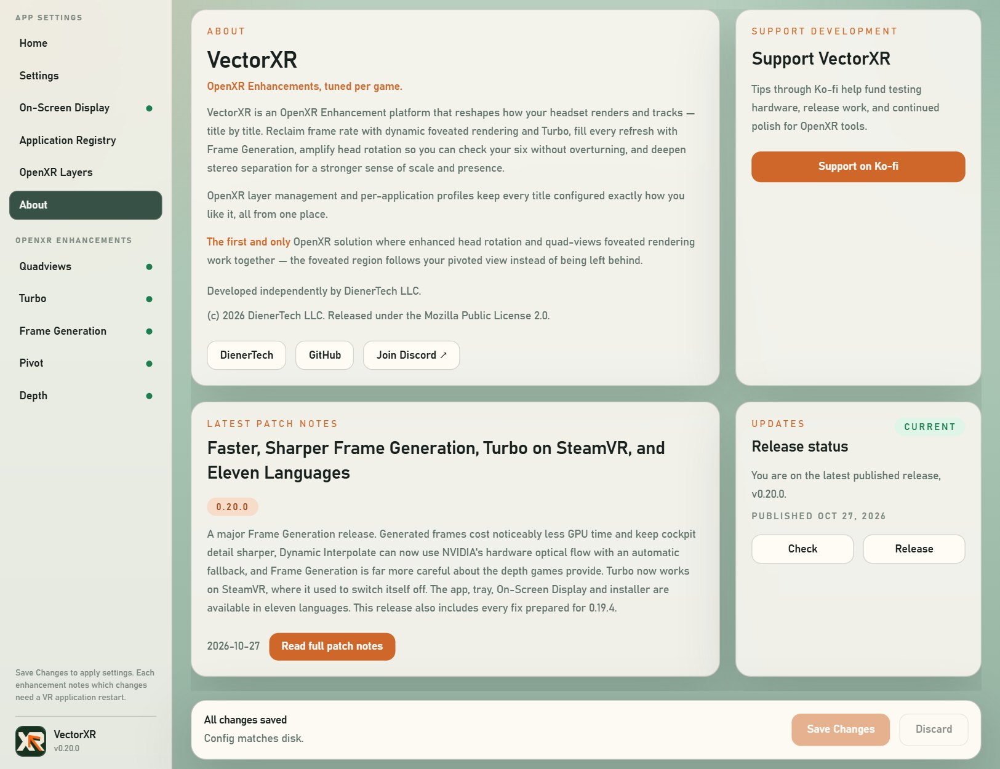

The **About** tab shows project info, support links, the latest patch notes, and a **Release
status** panel that checks GitHub for the newest published release. VectorXR does not auto-download
updates — install them manually from
[GitHub Releases](https://github.com/DienerTech/vectorxr/releases/latest).

**Join Discord** on Home and About loads the current DienerTech invitation online. The
button shows a loading state and stays disabled if the invitation is unavailable or the
request fails. Use **Retry** after reconnecting. The optional **VectorXR Updates** role in
Discord's **welcome-and-rules** channel lets you opt into release notifications.

## Disabling or removing VectorXR

VectorXR is designed to be reversible at every level:

- **Pause everything** — turn *VectorXR Enabled* off in Settings to stop all Enhancements without
  uninstalling.
- **Per Enhancement** — toggle any Enhancement off from the sidebar, or turn off its profiles.
- **Take it out of the pipeline** — disable the VectorXR layer from the OpenXR Layers tab.
- **Remove it** — uninstall from Windows to remove the app and unregister the API layer.
